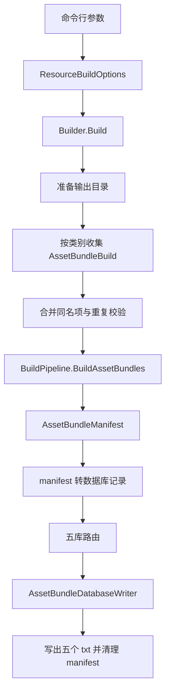

# 资源打包框架（C# 版）设计

- 日期 2026-11-24
- 状态 设计完成，待实施
- 目标包 com.spacetime.core
- 旧 Unity 参考 F:/proj_se/develop/client/project/Assets/LingRen/OldLingRen/Editor
- 新构建参考 D:/xieliujian/spacetime_build

## 1. 背景

旧工程把资源打包拆在三处。Unity 侧的 `ResBuilder` 生成 AssetBundle，Python 侧的
`tools/build/com/assetbundledb.py` 从 manifest 生成五个客户端数据库并写入 Redirect 行，
上传与出包再由别的任务完成。三处分别维护命名、依赖和索引规则，任何一处改动都要三边对齐。

`spacetime_build` 已经把资源任务模型、五库路由和兼容协议抽成纯 Python 实现，但真实
Unity 构建仍要经过 C#。这一步的目标是把「Unity 生成 AssetBundle 并产出客户端数据库」
整段搬到 C#，让打包只依赖 Unity 进程，Python 侧继续负责发布、上传与平台打包。

## 2. 范围

### 2.1 本期实现

1. 五个客户端数据库的生成与写出，文件名为 `assetbundledb_scene.txt`、
   `assetbundledb_ui.txt`、`assetbundledb_other.txt`、`assetbundledb_character.txt`、
   `assetbundledb_particle.txt`。
2. 按资源类别收集 AssetBundle 构建项，覆盖 UI、角色、特效、场景、剧情、Shader 与音频，
   合并同名项，校验重复资源与名字长度。
3. 调用 `BuildPipeline.BuildAssetBundles`，把返回的 manifest 转成数据库记录。
4. 支持依赖与可选 Redirect 切片的编码，Redirect 的容器合成不在本期。
5. 命令行入口，供 CI 与本地批处理调用。

### 2.2 本期不做

1. 不生成六字段文件列表，不做 CDN 上传、版本激活与回滚。
2. 不做合包（Redirect 容器生成），只支持把已有的容器切片写进数据库。
3. 不做分包、低清变体、IL2CPP、SDK 与平台包体。
4. 不定义资源归属规则。哪个资源进哪个 Bundle 仍由工程的 AssetImporter 或资源规则决定。

### 2.3 与 `spacetime_build` 的边界

| 能力 | spacetime_build | 本设计 |
| --- | --- | --- |
| 任务模型与 DAG | 已实现纯 Python 契约 | 不实现 DAG，按类别顺序收集 |
| Unity 构建执行 | 只有适配器契约 | 直接调用 BuildPipeline |
| 五库路由 | `compatibility/assetbundle_routing.py` | 等价实现 |
| 数据库编码 | `compatibility/assetbundle_writer.py` | 等价实现 |
| 发布、上传、平台包体 | 部分规划 | 不做 |

## 3. 与 Python 实现的对应关系

| Python 模块 | C# 模块 | 职责 |
| --- | --- | --- |
| `resource/model.py` | `EResourceBuildScope`、`EResourceBuildPlatform` | 类别与平台枚举 |
| `resource/unity_operations.py` | `Builder` 内部映射 | 平台到 BuildTarget 的转换 |
| `compatibility/assetbundle_dto.py` | `AssetBundleDatabaseRecord` 等 | 数据库记录模型 |
| `compatibility/assetbundle_routing.py` | `AssetBundleDatabaseRouter` | 路径到数据库的固定归属 |
| `compatibility/assetbundle_writer.py` | `AssetBundleDatabaseWriter` | 确定性文本编码 |
| `resource/unity_builder.py` | `Builder` | 构建执行 |
| `resource/production.py` | `Builder.Build` | 入口编排 |

## 4. 现状核对

### 4.1 旧 Unity 打包行为

1. `Builder.Build` 解析命令行参数，按 `BUILD_UI`、`BUILD_SCENE`、
   `BUILD_CHARACTER` 等开关反射调用各类 Builder 的 `OnPrepare`、
   `OnSetBundleNames`、`OnBuild`，最后统一进入 `BuildBundleBuild`
   （`Builder.cs:632`）。
2. 构建选项固定为 `ChunkBasedCompression | IgnoreTypeTreeChanges`，Android 与 iOS
   打 UI 或剧情时改成 `ChunkBasedCompression | DisableWriteTypeTree`
   （`Builder.cs:642`）。
3. Bundle 名就是客户端逻辑路径，直接带 `.assetbundle` 后缀，variant 为空
   （`EditorUtils.cs:1250`）。
4. 运行时解析五个数据库，按需再解析 `assetbundledb_forceupdate.txt`
   （`AssetBundleDBMgr.cs:160`）。
5. 依赖与 Redirect 的引用都写成同一个数据库文件内的序号
   （`assetbundledb.py:35`）。

### 4.2 包内现状

`Editor/Scripts/ResourceLoad/Packager.cs` 是演示工程的打包工具。它扫描 `Assets/Package/`
下固定子目录，一个资源生成一个 Bundle，variant 写 `unity3d`，只生成单个
`assetbundledb.txt`。这套规则与客户端工程的目录结构和命名都不一致，不能直接扩展。

### 4.3 运行时消费契约

数据库必须满足三个条件才能被客户端加载。

1. Bundle 名与磁盘相对路径一致，例如 `ui/panelui/mainpanel.assetbundle`。
2. 每条记录的依赖都在同一个数据库内，跨库依赖不允许。
3. 依赖与 Redirect 使用同库内的连续序号。

## 5. 总体架构



整条链路只在编辑器内运行，不进入运行时程序集。数据库编码与路由不依赖 Unity API，
可以单独做单元测试。

## 6. 数据模型

### 6.1 记录与数据库

| 类型 | 字段 | 说明 |
| --- | --- | --- |
| `AssetBundleRedirectSlice` | `containerName`、`offset`、`length` | 合包容器与字节切片 |
| `AssetBundleDatabaseRecord` | `name`、`dependencies`、`redirect` | 一条 AssetBundle 记录 |
| `AssetBundleDatabase` | `databaseName`、`records` | 一个独立编号空间 |
| `AssetBundleDatabaseSet` | 五个 `AssetBundleDatabase` | 固定顺序的客户端数据库集合 |

`dependencies` 保持原顺序并允许重复，与 Unity manifest 的输出一致。
`redirect` 为空表示这个 Bundle 是独立文件。

### 6.2 路径路由

路由规则与 `assetbundle_routing.py` 完全一致。

| 前缀 | 数据库 | 说明 |
| --- | --- | --- |
| `scene/`、`story/`、`lingren/resources/global/` | `assetbundledb_scene.txt` | 场景与剧情 |
| `ui/` | `assetbundledb_ui.txt` | UI |
| `texture/`、`skill/` | `assetbundledb_other.txt` | 贴图与技能 |
| `character/` | `assetbundledb_character.txt` | 角色 |
| `particle/` | `assetbundledb_particle.txt` | 特效 |
| `depend/shader_` 开头且以 `.assetbundle` 结尾 | 全部五个库 | shader 共享依赖，记录复制到每个库 |
| 其他 `depend/` 路径 | 无 | 直接报错，不猜测归属 |

shader 共享依赖作为一条记录复制到五个库，而不是只在其中一个库存放。复制后的记录内容相同，
但序号按各自库的排序重新分配。

### 6.3 文本格式

```text
<Bundle 逻辑路径>\t<库内序号>
\tDepend:<依赖序号>\t<依赖序号>...
\tRedirect:<容器序号>\t<偏移>\t<长度>
```

编码规则如下。

1. 记录按名字做序数排序，序号从零连续分配。
2. `Depend` 与 `Redirect` 每库最多各一行，缺省时整行不输出。
3. 换行由选项决定，整文件统一使用 LF 或 CRLF，并在文件末尾保留一个换行。
4. 空库输出零字节文件。
5. 编码使用 UTF-8，不写 BOM。

示例，输入三条记录后按名字排序得到如下内容。

```text
depend/shader_ui.assetbundle	0
ui/a.assetbundle	1
	Depend:0
ui/b.assetbundle	2
	Depend:0	1
	Redirect:1	1024	2048
```

### 6.4 不变量

写出前必须通过以下检查，任一项失败都中止打包。

1. 同一库内 Bundle 名不重复。
2. 每条依赖都能在同一库内找到记录。
3. 依赖图无环。
4. Redirect 容器在同一库内存在，偏移非负，长度为正。
5. Bundle 名不超过 165 字符。

## 7. 构建流程

### 7.1 准备输出

输出根目录默认取 `FilePath.streamingAssetsPath`，编辑器下就是工程根目录的 `BuildRes/`。
调用方可以覆盖为任意绝对路径。`isCleanOutput` 为真时先删目录再重建，默认关闭，
避免误删既有资源。

### 7.2 收集构建项

收集来源是 `AssetImporter.assetBundleName`。工程里的资源规则负责给资源打上名字，
本框架只负责读取。

```csharp
string[] bundleNames = AssetDatabase.GetAllAssetBundleNames();
string[] assetPaths = AssetDatabase.GetAssetPathsFromAssetBundle(bundleName);
```

每个类别对应一个收集任务，任务只接受自己前缀的 Bundle。类别未启用时任务不注册，
对应的资源既不构建也不进数据库。

自定义规则通过继承 `ResourceBuilderBase` 注入。基类负责按前缀过滤和读取 AssetDatabase，
子类可以重写 `IsBundleAccepted` 收紧命名规则，或重写 `Collect` 追加类别检查。

覆盖范围校验单独执行。任何无法归类的 Bundle 名都会报错，避免资源悄悄漏进其他库。

### 7.3 合并与校验

同类别的多个任务可能登记同一个 Bundle 名，按名字合并资源列表。合并时维护
「资源路径到 Bundle 名」的映射，同一个资源出现在两个 Bundle 里直接报错，同名 Bundle
内的重复资源也报错。

### 7.4 构建参数

| 平台 | BuildTarget | BuildTargetGroup |
| --- | --- | --- |
| Android | `Android` | `Android` |
| iOS | `iOS` | `iOS` |
| Windows | `StandaloneWindows64` | `Standalone` |

构建选项与旧工程保持一致。默认使用 `ChunkBasedCompression | IgnoreTypeTreeChanges`，
Android 与 iOS 且启用了 UI 或场景类别时改用 `ChunkBasedCompression | DisableWriteTypeTree`。
当前类别精度无法区分「场景」与「剧情」，移动端开启场景类别会一并关闭 TypeTree，
迁移时需要确认这一差异是否可接受。

### 7.5 manifest 转记录

`AssetBundleManifest.GetAllAssetBundles()` 给出本次实际构建的 Bundle 名，
`GetAllDependencies(name)` 给出直接依赖。每个 Bundle 生成一条记录后交给路由，
同一个记录对象会被加入一个或多个数据库。

### 7.6 写库与清理

五个库依次写出到输出根目录。全部写完后删除 Unity 生成的清单文件，包括输出目录同名的
根 Bundle、根清单文本以及所有 `*.manifest`。`builds.txt` 作为可选诊断产物，
记录每个 Bundle 包含的资源路径。

## 8. 代码结构

全部放在 `Editor/Scripts/Build/`，命名空间 `ST.Core`。

| 文件 | 类型 | 职责 |
| --- | --- | --- |
| `Builder/Builder.cs` | static partial | 命令行入口、主流程与构建执行 |
| `Builder/Builder_*.cs` | static partial | Define、Collect、Merge、Target、Output、CommandLine 六个职责拆分 |
| `Builders/ResourceBuilderBase.cs` | abstract | 按前缀过滤并读取 AssetDatabase |
| `Builders/UIBuilder.cs` | class | 收集 `ui/` |
| `Builders/CharacterBuilder.cs` | class | 收集 `character/` |
| `Builders/ParticleBuilder.cs` | class | 收集 `particle/` |
| `Builders/SceneBuilder.cs` | class | 收集 `scene/` 与全局资源 |
| `Builders/StoryBuilder.cs` | class | 收集 `story/`，记录写入场景库 |
| `Builders/ShaderBuilder.cs` | class | 收集 `depend/shader_`，记录复制到五库 |
| `Builders/AudioBuilder.cs` | class | 收集 `audio/`，记录写入 other 库 |
| `Config/BuildDefine.cs` | 常量与枚举 | 数据库名、路径前缀、容器容量、行前缀、参数名与日志模板 |
| `Config/ResourceBuildOptions.cs` | class | 平台、输出目录、类别、换行与自定义构建器 |
| `Config/ResourceBuildContext.cs` | class | 日志、错误收集与 Bundle 名缓存 |
| `Database/AssetBundleDatabaseTypes.cs` | 数据类 | Redirect、记录与数据库 |
| `Database/AssetBundleDatabaseRouter.cs` | static | 路径到数据库的归属 |
| `Database/AssetBundleDatabaseWriter.cs` | static | 校验与确定性编码 |
| `Database/AssetBundleDatabaseSet.cs` | class | 五库聚合、manifest 转换与写出 |

编码与路由保持纯函数，不引用 `UnityEditor`，便于在 EditMode 测试里直接断言字节输出。

## 9. 入口

### 9.1 命令行

| 参数 | 说明 |
| --- | --- |
| `-resourcePlatform android|ios|windows` | 目标平台，缺省取当前活动平台 |
| `-resourceOutput <绝对路径>` | 输出根目录，缺省为 `BuildRes/` |
| `-resourceScopes scene,ui,character` | 参与打包的类别，缺省全部 |
| `-resourceClean` | 打包前清空输出目录 |

调用方式。

```text
Unity.exe -batchmode -quit -projectPath <project>
  -executeMethod ST.Core.Builder.Build
  -resourcePlatform android -resourceScopes ui,character,shared
```

批量模式下失败时以非零状态退出，供 CI 判定。

## 10. 运行时配套

打包产物要能被包内加载器消费，运行时还需要三处改动，建议与打包实现同批提交。

### 10.1 多数据库

新增可选接口，避免破坏已有 `IResourceConfig` 实现。

```csharp
public interface IMultiAssetBundleDBConfig : IResourceConfig
{
    string[] assetBundleDBFiles { get; }
}
```

`AssetBundleLoad` 初始化时判断配置是否实现该接口。实现时按数组逐个解析，
未实现时沿用单库。`AssetBundleDBMgr` 已经支持多文件解析，改动集中在初始化入口。

### 10.2 路径解析

Bundle 完整路径改走 `FileMgr.GetResPathInPersistentOrStream`，让热更目录优先于包内目录。
当前实现直接拼接 `streamingAssetsPath + appName + "/" + respath`，客户端工程没有
appName 子目录，且无法命中热更后的文件。

### 10.3 Redirect

Redirect 属于体积与 IO 优化，可以后置。结构上需要给 `AssetBundleInfo` 增加
`redirectName`、`offset`、`length`，解析 `\tRedirect:` 行，并在同步与异步加载时
把 offset 传给 `AssetBundle.LoadFromFile`。未实现前，数据库中不写 Redirect 行即可
正常工作。

## 11. 错误处理

| 场景 | 处理 |
| --- | --- |
| 输出目录为空或创建失败 | 中止，记录绝对路径与异常信息 |
| 切换构建目标失败 | 中止，不继续构建 |
| 未收集到任何 Bundle | 中止，避免写出空库覆盖旧资源 |
| Bundle 名前缀无法归类 | 中止，列出全部无法归类的名字 |
| 资源被多个 Bundle 引用 | 中止，列出资源路径与两个 Bundle |
| Bundle 名超过 165 字符 | 中止，列出超长名字 |
| 库内依赖缺失或成环 | 中止，指出具体记录 |
| `BuildPipeline` 返回空清单 | 中止，保留日志 |

所有错误通过 `STLogger.LogError` 输出并写入上下文，最终汇总错误数量。警告用于
可继续的场景，例如 Bundle 缺少 `.assetbundle` 后缀。

## 12. 测试与验证

### 12.1 自动化

1. 路由测试覆盖五类前缀、shader 共享依赖、未知 `depend/` 路径与未知前缀。
2. 写出测试用固定记录比对完整字节，包含排序、重复依赖、Redirect 与两种换行。
3. 校验测试覆盖重复名、缺失依赖、依赖环与缺失容器。
4. 合并测试覆盖同名 Bundle 合并与跨 Bundle 重复资源报错。

写出测试的期望字节应与 `spacetime_build` 的 Golden 输出一致，这是两侧兼容的主要保障。

### 12.2 手工验证

1. 在工程内给少量资源设置 `assetBundleName`，分别属于五个类别。
2. 执行命令行打包，确认输出目录出现五个 txt 与对应 Bundle。
3. 检查 Bundle 数量、依赖行与库内序号与旧流程一致。
4. 用旧客户端解析器读取新库，确认无报错。
5. 关闭某个类别后重跑，确认该类别记录消失且其他库不受影响。

### 12.3 迁移验证

在隔离副本中，对同一份资源规则分别运行旧 `ResBuilder + assetbundledb.py` 与新 C# 流程，
比较 Bundle 集合、依赖集合、库内序号与文件哈希。比较结果作为切换前置条件。

## 13. 实施步骤

| 阶段 | 内容 | 验收 |
| --- | --- | --- |
| 1 | 数据模型、路由、writer 与单测 | 字节输出与 Python Golden 一致 |
| 2 | 收集任务、合并校验与 BuildPipeline 调用 | 小工程能生成五个库 |
| 3 | 命令行入口与日志 | 批处理可运行 |
| 4 | 运行时多库与 FileMgr 路径 | 包内能加载新库产出的 AB |

Redirect 支持作为独立增量放在第四阶段之后。

## 14. 风险

1. 资源规则来源不统一。旧工程部分 Bundle 由 Builder 显式登记，不完全来自 AssetImporter，
   迁移前需要确认所有 Bundle 都有 importer 名字，否则会漏包。
2. 跨库依赖。旧数据里如果存在 UI Bundle 依赖 `texture/` 记录，writer 会拒绝写出。
   这种情况下需要把依赖改成 shader 公共库，或者调整路由规则。
3. 平台切换代价。`SwitchActiveBuildTarget` 会触发资源重导入，批量任务应尽量按平台分组运行。
4. TypeTree 策略。类别粒度比旧 `BUILD_STORY` 粗，移动端场景打包会一并关闭 TypeTree。
5. Android 包内加载。`AssetBundle.LoadFromFile` 不能直接读 APK 内的 StreamingAssets，
   运行时需要继续依赖 `FileMgr` 的解包与拷贝能力。

## 15. 待确认

1. `Packager.cs` 保留为演示工程工具，还是由新框架完全取代。
2. Redirect 合包是否也迁到 C#，还是继续由发布工具生成。
3. 是否需要在新框架内直接生成六字段文件列表，或者等待发布模块迁移。
