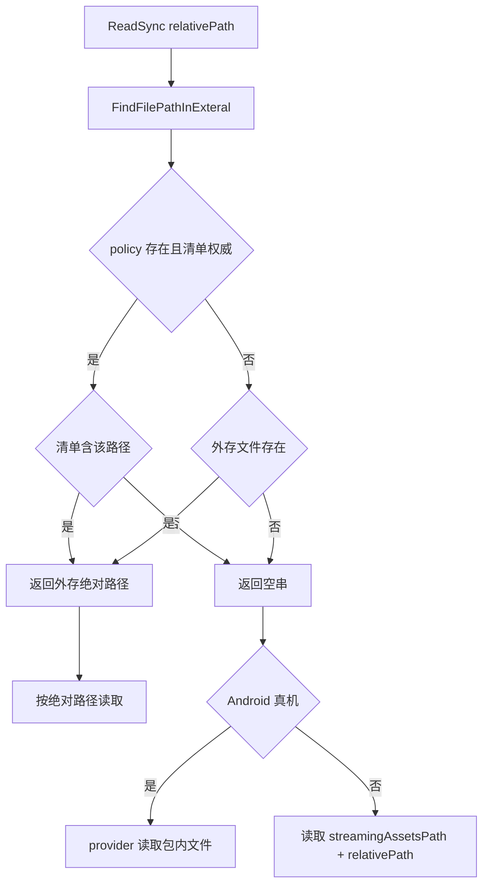

# FileMgr 与 FilePath 迁移设计

- 日期 2026-11-23
- 状态 已实现，待验证
- 目标包 com.spacetime.core
- 来源 F:/proj_se/develop/client/project/Assets/Script/LogicModule/FileModule

## 1. 背景

旧工程在 `Assets/Script/LogicModule/FileModule` 下维护了一套原始文件访问层，负责把业务传入的相对路径解析成外存或包内的绝对路径，再按平台读取字节。新框架 `com.spacetime.core` 目前只有 AssetBundle 资源加载，没有原始文件访问能力。热更新清单、Lua 脚本、表文件、`appconfig.json`、音频 bank、场景 bin、技能 bin 这些读取路径在业务侧各自依赖旧实现。

这次迁移把这套能力收进核心包，同时切断它对旧内核 `GameWorld.gameKernel`、`SoulEngine`、`zstring` 的依赖。

## 2. 目标

1. `FilePath` 与 `FileMgr` 以 `ST.Core` 命名空间进入 `Runtime/Scripts/Core/IO/`。
2. 相对路径解析语义保持不变，外存优先，包内兜底，清单可用时以清单为准。
3. 外存清单判断、Android inner 目录、APK 包内读取通过接口由业务注入。
4. 旧工程替换命名空间后，`FilePath` 的 159 处引用与 `FileMgr` 的全部引用行为一致。
5. 顺带修掉读取不完整、超长路径建目录失败、日志锁对象错误三处缺陷。

## 3. 非目标

- 不改动 AssetBundle 的加载与打包流程。
- 不引入异步文件读取 API，第一期只提供同步读取。
- 不迁移 `DecyptUtils`，RSA 私钥属于加密工具，不进入核心包。
- 不迁移 `BinReadModule`，它依赖业务线程池 `ThreadRequestModule`。
- 不引入 `zstring` 依赖，也不保留对应重载。

## 4. 现状核对

### 4.1 调用面

| 对象 | 旧工程引用规模 | 典型用途 |
| --- | --- | --- |
| `FilePath` | 159 处 | 目录拼接、文件是否存在、全量读文本 |
| `FileMgr.ReadSync` | 二十余处 | Lua、表、技能、场景、音频、配置 |
| `FileMgr.GetResPathInPersistentOrStream` | 十余处 | 交给外部库按路径加载 |
| `FileMgr.fileLogger` | 7 处 | 资源访问日志导出与手工写入 |
| `FileMgr.WriteString2File` | 21 处 | GM 与调试信息落盘 |

### 4.2 外部依赖

| 依赖 | 位置 | 新包现状 | 处理 |
| --- | --- | --- | --- |
| `GameWorld.gameKernel` `FileListModule` `GMModule.debugLua` | FileMgr.cs:477 | 无内核与模块系统 | 抽 `IFileResolvePolicy` |
| `TSingleton<T>` 懒加载单例 | LR.TSingleton | 无该基类 | 改静态类 |
| `zstring` | FileMgr.cs:45 / 268 | 零引用 | 只保留 string 重载 |
| `Debugger` `SafeFormat` | FileMgr 各处 | 只有 `STLogger` | 换日志入口 |
| `LRFileHandler` `AndroidNative` | FilePath.cs:30 / FileMgr.cs:200 | 无原生库 | 抽 `IPlatformFileProvider` |
| `ICSharpCode.SharpZipLib` | FileMgr.cs:8 | 未使用 | 删除 using |
| `FileLogger` | UpdateModule/FileLogger.cs | 只有 `LogFileWriter` | 迁入核心包 |

### 4.3 既有缺陷

1. `ReadFile(path, result)` 只调用一次 `FileStream.Read`，并返回 `result.Length`。`Read` 不保证读满，调用方会把半截数据当成完整数据，返回长度也与文件长度无关。位置 FileMgr.cs:349。
2. `ReadFile(path)` 同样是单次 `Read`，大文件或慢盘上会静默拿到不完整数据。位置 FileMgr.cs:330。
3. 各目录 getter 用 `Directory.CreateDirectory` 建目录时没有套 `GetWindowsWarpPath`，超过 260 字符时建目录失败，后续读写用的是扩展路径，日志会指向错误位置。
4. 访问日志的锁对象是 `string.Empty`，这是进程内驻留字符串，等价于锁全局空串。位置 FileMgr.cs:19。
5. `FileLogger.PushLog` 先入缓存再判断脚本告警过滤，过滤永远不会生效。

## 5. 架构设计

### 5.1 文件布局

```text
Runtime/Scripts/Core/IO/
    Binary/
        BitStreams.cs
        ByteBuffer.cs
    File/
        Contract/
            IFileResolvePolicy.cs      外存清单判定
            IPlatformFileProvider.cs   平台目录与包内读取
        FileMgr/
            FileMgr.cs             对外路径解析接口
            FileMgr_Define.cs      清单、日志与开关状态
            FileMgr_Read.cs        读取对外接口与包内分发
            FileMgr_ReadFile.cs    物理读取与读满校验
            FileMgr_Write.cs       文本写入与包内拷贝
            FileMgr_AccessLog.cs   资源访问日志记录
            FileMgr_Android.cs     Android 包内读取
        FilePath/
            FilePath.cs            路径属性与缓存刷新
            FilePath_Define.cs     根目录缓存与平台实现引用
            FilePath_Platform.cs   平台根目录解析与目录创建
            FilePath_IO.cs         Windows 超长路径与低层文件操作
        FileLogger/
            FileLogger.cs          日志属性与构造
            FileLogger_Define.cs   日志状态与文件句柄
            FileLogger_Write.cs    写入、刷新与快照导出
```

`Core/IO` 下只放子目录。字节流放在 `Binary`，文件访问放在 `File`，`File` 下再按类族分文件夹，沿用 `Launch/Module` 的组织方式。

三个类使用 `partial` 拆分，命名沿用仓库已有的 `LaunchModule_Define` / `LaunchModule_Node` 约定。

### 5.2 核心流程



关键点在于清单权威分支不探测磁盘。清单记录存在但文件被手工删掉时，解析结果仍是外存路径，读取失败。这条语义今天就是这样，迁移时保留。

### 5.3 两个注入接口

```csharp
/// <summary>外存资源清单判定，由业务的更新模块实现。</summary>
public interface IFileResolvePolicy
{
    /// <summary>清单是否可以作为唯一判定依据，为 <c>true</c> 时不再探测磁盘。</summary>
    bool IsManifestAuthoritative();

    /// <summary>相对路径是否记录在外存清单中。</summary>
    bool ExistInExternal(string relativePath);
}

/// <summary>平台相关文件能力，承载 Android inner 目录与 APK 包内读取。</summary>
public interface IPlatformFileProvider
{
    /// <summary>外存根目录，返回空串或 null 时使用 Unity 默认目录。</summary>
    string GetPersistentDataPath();

    /// <summary>application dataPath，Android 分包时返回主资源包路径。</summary>
    string GetDataPath();

    /// <summary>当前是否是 Android App Bundle 安装。</summary>
    bool IsAppBundle();

    /// <summary>包内是否存在该相对路径。</summary>
    bool IsFileInPackage(string relativePath);

    /// <summary>读取包内文件全部字节，失败返回 null。</summary>
    byte[] ReadFromPackage(string relativePath);

    /// <summary>把包内文件读入调用方缓冲区，返回实际读取字节数，失败返回 -1。</summary>
    int ReadFromPackage(string relativePath, byte[] result);

    /// <summary>把包内文件拷贝到外存绝对路径，失败返回 false。</summary>
    bool CopyFromPackage(string relativePath, string outAbsPath);
}
```

两个接口都可以不注入。不注入时 `IFileResolvePolicy` 走扫描分支，`IPlatformFileProvider` 走 `System.IO` 分支，与今天「清单未就绪」的表现一致。这是迁移可以分期的前提。

Android 真机下 provider 为空时，包内读取会打一条错误日志并返回失败，避免静默返回空数据。

### 5.4 路径实现收敛

`FilePath.streamingAssetsPath` 与 `FilePathHelper.GetFilePath()` 算的是同一个根目录。核对结果是 Editor、Windows 播放器、Android、iOS 上完全一致，只有 Linux 播放器有分歧。处理方式是 `FilePathHelper.GetFilePath()` 直接返回 `FilePath.streamingAssetsPath`，判定逻辑只保留在 `FilePath` 里，改用 `Application.platform` 判断 Windows 播放器，其余非 Editor 平台统一返回 `Application.streamingAssetsPath`。

`AppPlatform.GetStreamingAssetsPath(appName)` 改为基于同一个根目录拼接小写 appName，只影响 Editor 打包工具，运行时结果不变。

原始资源根目录保持 `BuildRes/`，不加 appName 子目录。AssetBundle 继续放在 `BuildRes/<appName>/`。这样旧工程的资源目录布局不需要调整。

`FilePathHelper.GetParentDir` 删除，统一调用 `FilePath.GetParentDir`。

## 6. 详细设计

### 6.1 FilePath

静态类，成员名与旧实现完全一致，减少调用点改动。

| 成员 | 说明 |
| --- | --- |
| `persistentDataPath` | 外存根目录，Android 优先取 provider |
| `streamingAssetsPath` | 包内根目录，Editor 与 Windows 播放器为 BuildRes |
| `streamingAssetsPathWithScheme` | 包内根目录的 file 协议形式 |
| `dataPath` | `Application.dataPath`，Android 分包时取主资源包 |
| `persistentDataPath4Res` `4Bin` `4ChatMedia` `4CameraMedia` `4Log` `4Temp` `4NetTexture` | 业务子目录，首次访问创建 |
| `isAppBundle` | 转发 provider，未注入时返回 false |
| `GetWindowsWarpPath` | Windows 超长路径转扩展路径 |
| `FileExists` `FileDelete` `FileCopy` `FileMove` `FileOpenRead` `FileReadAllText` `FileReadAllBytes` | 统一套扩展路径的低层封装 |

新增两个方法。

```csharp
/// <summary>注入平台实现，重复设置会清空已缓存的根目录。</summary>
public static void SetPlatformProvider(IPlatformFileProvider provider)

/// <summary>清空所有缓存的根目录，平台环境变化后调用一次。</summary>
public static void ResetCache()
```

`ResetCache` 同时重置 `persistentDataPath`、`streamingAssetsPath`、`dataPath` 与全部业务子目录。旧实现的 `InitStreamingAssetPath()` 只重置包内路径，Android 上外存路径如果被提前读取会永久停在错误值。

目录创建改为 `Directory.CreateDirectory(GetWindowsWarpPath(dir))`，修掉缺陷 3。iOS 的 `SetNoBackupFlag` 保留。

### 6.2 FileMgr

静态类，状态字段使用 `s_` 前缀。

| 成员 | 说明 |
| --- | --- |
| `SetResolvePolicy` | 注入外存清单判定 |
| `isAccessLogEnabled` | 是否记录资源访问日志，代替 `m_LoggerEnable` |
| `fileLogger` | 资源访问日志实例，未启用时为 null |
| `GetResPathInPersistentOrStream` | 外存优先，包内兜底 |
| `IsInExternal` `IsFileExists` | 存在性判断 |
| `ReadSync` 两个重载 | 非线程安全读取 |
| `ReadSyncInThread` 两个重载 | 线程安全的绝对路径读取 |
| `ReadSyncInternal` `ReadSyncExtenal` | 强制指定来源的读取 |
| `ReadSyncByAbsoluteFilePath` | 绝对路径读取 |
| `WriteString2File` | UTF-8 覆盖写文本 |
| `FindFilePathInExteral` `FindFilePathInternal` | 路径解析 |
| `CopyDataFromAndroidApk` | 包内文件拷到外存 |

`m_SearchDirList` 删除。旧实现只在初始化时加过 `persistentDataPath4Res` 一个目录，改成直接使用该属性，同时解决缓存到过期路径的问题。

读取实现统一走一个私有方法，保证读满，修掉缺陷 1 与 2。

```csharp
/// <summary>把流读到缓冲区，直到读满或流结束，返回实际读取字节数。</summary>
static int ReadFully(FileStream fileStream, byte[] buffer)
{
    int totalRead = 0;

    while (totalRead < buffer.Length)
    {
        int readLength = fileStream.Read(buffer, totalRead, buffer.Length - totalRead);
        if (readLength <= 0)
        {
            break;
        }

        totalRead += readLength;
    }

    return totalRead;
}
```

`ReadFile(path, result)` 的返回值改为实际读取字节数。缓冲区小于文件长度时返回 -1 并记录错误。

访问日志改为 `s_FileLogLock` 专用锁对象，修掉缺陷 4。日志文件路径仍为 `persistentDataPath4Temp + "FileLog.txt"`。

### 6.3 FileLogger

迁入 `Core/IO/FileLogger.cs`，保留对外 API，供 `FileMgr.fileLogger` 与调试导出使用。

| 成员 | 说明 |
| --- | --- |
| `maxFlushCount` `filePath` | 属性 |
| `FileLogger(path, append)` | 打开文件，超过 20MB 先删除 |
| `PushLog(log, flush)` | 入缓存，达到阈值刷新 |
| `Flush` `Close` | 落盘与关闭 |
| `CopyTo(destinationPath)` | 导出快照后重新以追加模式打开 |

删除 `BakAndReOpen` 与 `Update`。两者在旧工程零调用，`Update` 依赖逐帧驱动，保留会让人误以为自动刷新生效。

`The referenced script on this Behaviour` 过滤移到入缓存之前，修掉缺陷 5。

日志输出从 `Debugger` 换成 `STLogger`。资源访问日志由文件模块自己持有文件句柄，线程读取路径也能写入，这一点比走 `STLogger` 更可靠。

### 6.4 保留与删除

| 旧代码 | 处理 | 原因 |
| --- | --- | --- |
| `DecyptUtils` | 留在旧工程 | RSA 私钥与加密工具不属于文件层 |
| `BinReadModule` | 留在旧工程 | 依赖业务线程池与模块系统 |
| `GetResPathInPersistentOrStreamNonGC` | 删除 | 依赖 zstring，3 个调用点改 string 版本 |
| `FindFilePathInExteralNonGC` | 删除 | 同上 |
| `InitStreamingAssetPath` | 删除 | 由 `FilePath.ResetCache` 取代 |
| `m_LoggerEnable` | 改名 `isAccessLogEnabled` | 公共字段命名规范 |
| `using ICSharpCode.SharpZipLib` | 删除 | 未使用 |

## 7. 行为差异

1. `ReadSync(path, result)` 返回实际读取字节数。旧实现返回 `result.Length`，缓冲区大于文件时会把缓冲区长度当成数据长度。
2. Linux 独立播放器的包内根目录改为 `Application.streamingAssetsPath`，与 Windows 之外的平台保持一致。
3. `InitStreamingAssetPath()` 由 `FilePath.ResetCache()` 取代，调用方改为在平台初始化完成后调用一次。
4. `m_LoggerEnable` 改名为 `isAccessLogEnabled`，旧工程只有 FileMgr 内部引用。
5. 三个 zstring 重载调用点改用 string 版本，AssetBundleRes 中需要同步删掉本地 zstring 变量。
6. `FileLogger` 的两个无调用方法移除。
7. 资源访问日志中的脚本告警过滤开始生效，日志行数会略少于今天。
8. 外存绝对路径不再出现重复斜杠。旧实现用 `dir + "/" + file` 拼接，而目录本身已带尾斜杠。
9. 外存读取不再重复解析路径，一次读取只记录一条访问日志。
10. `GetWindowsWarpPath` 在 Windows Editor 下也生效，不再受当前活动构建目标影响。

## 8. 旧工程接线

### 8.1 命名空间

```csharp
using ST.Core;
```

需要保留短名的地方用别名。

```csharp
using FilePath = ST.Core.FilePath;
using FileMgr = ST.Core.FileMgr;
```

### 8.2 调用替换

| 旧写法 | 新写法 |
| --- | --- |
| `FileMgr.S.ReadSync(path)` | `FileMgr.ReadSync(path)` |
| `FileMgr.S.ReadSyncInThread(...)` | `FileMgr.ReadSyncInThread(...)` |
| `FileMgr.S.fileLogger` | `FileMgr.fileLogger` |
| `FileMgr.S.m_LoggerEnable` | `FileMgr.isAccessLogEnabled` |
| `FileMgr.S.InitStreamingAssetPath()` | `FilePath.ResetCache()` |
| `FileMgr.S.GetResPathInPersistentOrStreamNonGC` | `FileMgr.GetResPathInPersistentOrStream` |

### 8.3 清单策略实现

在旧工程 FileModule 目录下新增适配器，忠实复刻 `TryInitFileListModule` 的判定。

```csharp
/// <summary>把旧内核的 FileListModule 与 GM 调试开关适配成框架的清单策略。</summary>
public sealed class LRFileResolvePolicy : IFileResolvePolicy
{
    /// <summary>清单是否权威，GM 调试模式下始终返回 false，强制扫描外存目录。</summary>
    public bool IsManifestAuthoritative()
    {
        GameKernel kernel = GameWorld.gameKernel;
        if (kernel == null)
        {
            return false;
        }

        GMModule gmModule = kernel.GetModule<GMModule>();
        if (gmModule != null && gmModule.debugLua)
        {
            return false;
        }

        FileListModule fileListModule = kernel.GetModule<FileListModule>();
        if (fileListModule == null)
        {
            return false;
        }

        bool isDataReady = fileListModule.IsDataReady();
        return isDataReady;
    }

    /// <summary>相对路径是否记录在外存清单中。</summary>
    public bool ExistInExternal(string relativePath)
    {
        FileListModule fileListModule = GameWorld.gameKernel.GetModule<FileListModule>();
        if (fileListModule == null)
        {
            return false;
        }

        bool isExist = fileListModule.ExistInExternal(relativePath);
        return isExist;
    }
}
```

### 8.4 Android 平台实现

用 `LRFileHandler` 实现四个包内方法，`AndroidNative` 实现三个目录方法。全部调用点保持在 `UNITY_ANDROID && !UNITY_EDITOR` 内。

### 8.5 启动顺序

在 `GameLauncher` 里，平台 native 初始化完成后调用一次 `FilePath.ResetCache()`，再注入 policy 与 provider。原来两处 `InitStreamingAssetPath()` 换成 `ResetCache()`。

## 9. 实施步骤

1. 新建 `Runtime/Scripts/Core/IO/FilePath.cs`，迁移路径逻辑，收敛 `FilePathHelper` 与 `AppPlatform.GetStreamingAssetsPath`。
2. 新建两个接口文件与 `FileLogger.cs`。
3. 新建 `FileMgr.cs`，接入两个接口与新的读取实现。
4. 旧工程新增策略适配器与 Android provider，替换命名空间与调用写法，删除本地 FileModule 目录。
5. 按第 10 节验证。
6. 更新 `readme/ResourceLoad/ResourceLoad.md` 或新增 `readme/File/File.md`，记录注入方式与路径约定。

## 10. 验证

### 10.1 手工验证

- Editor 下 `ReadSync("appconfig.json")`、`ReadSync("script/x.lua")`、`ReadSync("skill/x.bin")` 都能读到。
- 同一相对路径在内包与外存都存在时，读到外存内容。
- 清单权威且清单含该路径时，删除外存文件后仍返回外存路径并读取失败。
- debugLua 打开时绕过清单，直接扫描外存目录。
- Windows 播放器下 `BuildRes` 路径正确，长度超过 260 字符的路径可以读写。
- Android 真机下包内读取、`CopyDataFromAndroidApk`、`dataPath` 分包路径都正确。
- 线程读取 `ReadSyncInThread` 在 Android 与桌面两条分支都返回正确长度。
- GM 导出资源日志仍能拿到 `FileLog.txt`。

### 10.2 自动化

新增一个 EditMode 测试 `FileMgrReadTest`，覆盖三个点。

1. 往 `persistentDataPath4Res` 写一个已知内容的临时文件，用大于文件长度的缓冲区读取，断言返回值为文件真实长度。
2. 注入一个返回权威结果的假 policy，断言 `FindFilePathInExteral` 命中清单与未命中清单两条分支。
3. 断言 `GetWindowsWarpPath` 对超长 Windows 路径输出扩展前缀。

测试结束重置 `FileMgr.SetResolvePolicy(null)`、`FileMgr.isAccessLogEnabled = false`、`FilePath.ResetCache()`，并删除临时文件。

## 11. 风险与后续

1. 静态状态在 Editor 反复进入 Play 模式时会残留。缓解方式是业务启动时重新注入并调用 `ResetCache`，测试侧在 TearDown 里清理。
2. Android 首次启动时 native 可能晚于首次读取就绪。缓解方式是在 native 初始化完成后调用 `ResetCache`。
3. `ST.Core` 里将同时存在 `FilePath.dataPath` 与 `AppPlatform.dataPath`，两者语义不同。后者当前零调用点，本次不动，文档里标注。
4. `FileLogger` 与 `LogFileWriter` 功能有重叠。保留前者是因为 `CopyTo` 导出快照与追加写入语义，后续可以考虑合并。
5. `ResourceLoad` 目前只读 `BuildRes/<appName>/` 下的 Bundle，不感知外存覆盖。把 AssetBundle 加载接到 `FileMgr` 的解析链上可以作为下一步独立工作。

